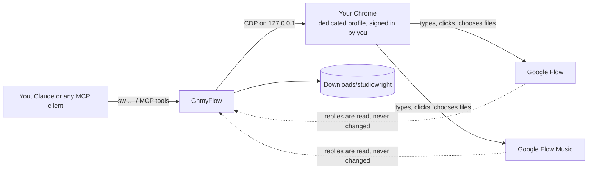

<div align="center">

# GnmyFlow

**Google Flow and Google Flow Music, from your terminal and your AI agent.**

Images, video clips and songs made in your own signed-in Chrome, on your own subscription.<br>
No API keys. No cookie exports. No captcha solvers. No browser extension.


</div>

> [!IMPORTANT]
> GnmyFlow is an unofficial fork of [StudioWright](https://github.com/umutkocak/studiowright), originally authored by Umut Koçak. It is not affiliated with, endorsed
> or sponsored by Google. It drives Flow's and Flow Music's web pages in **your** browser
> and spends **your** credits. Read the [disclaimer](#disclaimer) before you use it.

```bash
sw image "a lighthouse keeper with a teal coat, flat textured 2D" --aspect 16:9
sw video "he turns towards the sea" --start keeper.jpg --duration 4 --resolution 360p
sw music "moody indie folk, warm male vocal" --lyrics-file chorus.txt --length 1:00
```

## Contents

- [Showcase](#showcase)
- [Why GnmyFlow](#why-gnmyflow)
- [Features](#features)
- [Install](#install)
- [Quick start](#quick-start)
- [Use it from AI agents](#use-it-from-ai-agents)
- [Command reference](#command-reference)
- [Batch files](#batch-files)
- [Costs and safety](#costs-and-safety)
- [How it works](#how-it-works)
- [Troubleshooting](#troubleshooting)
- [Configuration](#configuration)
- [Development](#development)
- [Disclaimer](#disclaimer)

## Showcase

The showcase below was inherited from StudioWright and made with StudioWright, from one small batch file and two chat
messages.

```json
{"id": "keeper", "kind": "image", "prompt": "a lighthouse keeper with a teal coat, standing, flat textured 2D illustration", "refs": ["style.png"]}
{"id": "keeper-close", "kind": "image", "prompt": "close-up portrait of the same lighthouse keeper, flat textured 2D", "refs": ["keeper"]}
{"id": "keeper-clip", "kind": "video", "prompt": "the lighthouse keeper turns his head towards the sea, gentle wind", "start": "keeper", "resolution": "360p", "duration": 4}
```

<table>
<tr>
<td width="50%"><br><sub><b>keeper</b> · Nano Banana 2.1 · style from a reference image · 22 s</sub></td>
<td width="50%"><br><sub><b>keeper-close</b> · the same character, by referring to the first job · 21 s</sub></td>
</tr>
<tr>
<td width="50%"><br><sub><b>keeper-clip</b> · Omni Flash, 4 s, start frame from the first job · 32 s · 4 credits</sub></td>
<td width="50%"><a href="docs/media/beacon-in-the-dark.mp4"></a><br><sub><b>Beacon in the Dark</b> · written and sung by the Flow Music Producer · 37 s · 5 credits<br><a href="docs/media/beacon-in-the-dark.mp4">▶ listen (MP4)</a> · <a href="docs/media/beacon-in-the-dark.mp3">MP3</a></sub></td>
</tr>
</table>

The song took two chat turns:

```bash
sw music chat "Write a four-line chorus about a lighthouse keeper who waits for the ships."
sw music chat "Moody indie-folk please. Make the song now, about one minute long." --session <id from the first reply>
```

## Why GnmyFlow

Most ways to automate Google's media models need one of these: a paid API key, cookies
copied out of your browser, a captcha-solving service, an unpacked browser extension, or a
third-party relay that holds your session. GnmyFlow needs none of them.

| | Paid model APIs | Cookie-based wrappers | Hosted relays | **GnmyFlow** |
| --- | :---: | :---: | :---: | :---: |
| Uses the credits of your Flow / Flow Music plan | ✗ | ✓ | ✓ | **✓** |
| No API key or per-call billing | ✗ | ✓ | ✗ | **✓** |
| Your session never leaves your machine | ✓ | ✗ | ✗ | **✓** |
| No captcha solving or token forging | ✓ | ✗ | ? | **✓** |
| Every option of the web app | partial | partial | partial | **✓** |
| Images, video **and** music in one tool | ✗ | ✗ | partial | **✓** |

What makes it different:

- **It acts like you.** GnmyFlow types, clicks and chooses files in Flow's real pages,
  in a Chrome you signed in to yourself. It only *reads* the replies those pages receive,
  to learn ids and download links. It never forges, replays or alters a request.
- **One package, three front doors.** The same engine is a CLI (`sw`), an MCP server
  (`sw mcp`) and a Claude Code plugin.
- **Built for real production.** Price checks before you spend (`--dry-run`,
  `--max-credits`), resumable batch files that chain results, sized downloads (2K images,
  1080p/4K clips), pacing across processes, and a cooldown when Google asks for a break.
- **Fast on a warm tab.** About 20 s for an image, 30-60 s for a clip, 40 s for a song.

## Features

**Images (Google Flow)**
- Nano Banana 2.1 (default), Nano Banana Pro and Nano Banana 2 Lite.
- Aspect ratios 16:9, 4:3, 1:1, 3:4, 9:16; one to four images per call.
- Reference images from files or earlier results; each file is uploaded once per project
  and then reused by content.
- Downloads at Flow's own sizes: 1K (original), 2K (upscaled by Flow), 4K where the plan
  allows.

**Video (Google Flow)**
- Omni Flash (default), Veo 3.1 Lite, Fast and Quality.
- Text only, start frame, start and end frames, or ingredients (several reference images).
- Omni: 360p / 720p and 4, 6, 8 or 10 s. Aspect 16:9 or 9:16.
- Downloads at 720p, 1080p or 4K (upscaled by Flow), or as a GIF.
- `--dry-run` shows Flow's price without submitting; `--max-credits` refuses anything
  more expensive.

**Music (Google Flow Music)**
- Songs with your lyrics (any language) or instrumentals; Lyria 3.5 or Lyria 3 Pro;
  BPM, length (1:00-3:00), seed, title, and cover art from a file or a prompt.
- **Edit existing songs:** extend, cover in another style, replace a section, variation,
  trim.
- **Stems:** drums, bass, vocals and other, each as its own file.
- **Downloads:** WAV (48 kHz), M4A or MP3; vertical MP4 videos from Flow Music's
  templates.
- **The Producer agent:** chat with it to write lyrics, plan songs, remix your own audio
  or make AI music videos; songs it makes are saved automatically.
- **Your own audio:** upload a file and extend, cover or split it like any other song.

**Automation**
- CLI with `--json` output, an MCP server with 16 tools, and a Claude Code plugin with a
  skill.
- JSON Lines batch files that resume where they stopped and pass results between jobs.
- A job history (`sw jobs`) and a screenshot of the page whenever a job fails.

## Install

[GnmyFlow 0.3.1 is available on PyPI](https://pypi.org/project/gnmyflow/0.3.1/).
The existing `v0.3.0` tag predates the fork rename; use `v0.3.1` or later for GnmyFlow.

Requirements: Python 3.12+, [uv](https://docs.astral.sh/uv/), Google Chrome, and a Google
account with a Flow plan (images and video) and/or a Flow Music plan (music).

```bash
uv tool install gnmyflow==0.3.1
gnmyflow --version
```

Alternatively, use `pipx install gnmyflow==0.3.1`. For a pinned source installation,
use `uv tool install git+https://github.com/gunamaya/gnmyflow@v0.3.1`.
Installing the package does not install Google Chrome, sign you in, or configure MCP.

The primary command is `gnmyflow`. Compatibility aliases `sw` and `studiowright`
run the same CLI. Do not install both forks into the same environment: they share
the `studiowright` Python namespace and legacy commands.

<details>
<summary>From a local checkout (for development)</summary>

```bash
git clone https://github.com/gunamaya/gnmyflow.git
cd gnmyflow
uv sync
uv tool install --python 3.13 -e .
```

</details>

### Updating

- **Plugin** (MCP server and skill): `claude plugin update gnmyflow@gnmyflow`, or in
  Claude Code `/plugin` → Installed → gnmyflow → Update now; then `/reload-plugins`.
  Each plugin version runs the GnmyFlow release of the same version. To update
  automatically, turn it on once: `/plugin` → Marketplaces → gnmyflow → Enable
  auto-update.
- **Command line (PyPI)**: `uv tool upgrade gnmyflow` or `pipx upgrade gnmyflow`.
  Pin a specific version with `uv tool install --force gnmyflow==X.Y.Z`.
- **Command line (source)**: `uv tool install --force git+https://github.com/gunamaya/gnmyflow@vX.Y.Z`
  with the release you want (see [Releases](https://github.com/gunamaya/gnmyflow/releases)).

## Quick start

**1. Sign in once.** Chrome opens on a profile that belongs to GnmyFlow only. Sign in
to Google, open Flow once, then close the window.

```bash
sw auth login
sw auth login --url https://www.flowmusic.app/    # only if you will make music
```

Run `sw stop` first if GnmyFlow's Chrome is already running.

**2. Make something.**

```bash
sw image "a red fox in the snow, flat 2D" --aspect 1:1
sw video "slow push-in on a quiet harbour at dawn" --model veo-lite --dry-run   # price only
sw music "calm documentary underscore, soft piano, warm strings" --bpm 80 --length 1:30
```

Files land in `Downloads/studiowright` (change it with `--out`), and each command prints
their paths. Add `--json` for ids, sizes, timings and credits.

**3. Keep Chrome in the background.** `sw window hide` moves the window off-screen. Never
minimize it: a minimized Chrome stops rendering and Flow stalls.

## Use it from AI agents

Every client below runs `gnmyflow mcp` over stdio; `sw mcp` remains compatible.
If a client cannot find `gnmyflow`, give it the full executable path.

Generating takes real time (an image ~20 s, a clip up to a few minutes), so give the
client a generous tool timeout where it has one.

### Claude Code plugin (recommended)

The plugin adds the MCP server and a skill that teaches Claude the options, prices and
safe habits.

```bash
claude plugin install gnmyflow --marketplace anggi-susanto/gnmyflow
```

or inside Claude Code:

```text
/plugin marketplace add anggi-susanto/gnmyflow
/plugin install gnmyflow@gnmyflow
```

The plugin starts its own matching GnmyFlow release with `uvx`, so it needs only `uv`
and Chrome; installing `sw` separately is for the command line.

Then just ask:

> Make a 16:9 image of a lighthouse keeper, then a 4-second clip where he turns to the
> sea. Check the price first.
>
> Write a one-minute instrumental bed for a documentary intro and give me the stems.

### Claude Code (MCP server only)

```bash
claude mcp add --scope user gnmyflow -- gnmyflow mcp
```

For long video jobs, raise the tool timeout, e.g. `MCP_TOOL_TIMEOUT=900000` in your
environment.

<details>
<summary><b>Claude Desktop</b></summary>

Settings → Developer → Edit Config, then add the server to `claude_desktop_config.json`
(`%APPDATA%\Claude\` on Windows, `~/Library/Application Support/Claude/` on macOS):

```json
{
  "mcpServers": {
    "gnmyflow": { "command": "gnmyflow", "args": ["mcp"] }
  }
}
```

Quit Claude Desktop completely and start it again.
</details>

<details>
<summary><b>Cursor</b></summary>

`~/.cursor/mcp.json` (all projects) or `.cursor/mcp.json` (one project):

```json
{
  "mcpServers": {
    "gnmyflow": { "command": "gnmyflow", "args": ["mcp"] }
  }
}
```
</details>

<details>
<summary><b>VS Code (GitHub Copilot)</b></summary>

`.vscode/mcp.json` (note the `servers` key):

```json
{
  "servers": {
    "gnmyflow": { "type": "stdio", "command": "gnmyflow", "args": ["mcp"] }
  }
}
```

For all workspaces, run **MCP: Open User Configuration** and add the same entry.
</details>

<details>
<summary><b>Codex CLI</b></summary>

```bash
codex mcp add gnmyflow -- gnmyflow mcp
```

or in `~/.codex/config.toml`:

```toml
[mcp_servers.gnmyflow]
command = "gnmyflow"
args = ["mcp"]
tool_timeout_sec = 900
```
</details>

<details>
<summary><b>Gemini CLI</b></summary>

```bash
gemini mcp add -s user gnmyflow gnmyflow mcp
```

or in `~/.gemini/settings.json`:

```json
{
  "mcpServers": {
    "gnmyflow": { "command": "gnmyflow", "args": ["mcp"], "timeout": 900000 }
  }
}
```
</details>

### MCP tools

| Tool | What it does |
| --- | --- |
| `flow_generate_image` | Images with any model, aspect, count, references and download size |
| `flow_generate_video` | Clips with any model and mode, frames, references, size; `dry_run`, `max_credits` |
| `flow_upload` / `flow_download` | Upload references once; fetch existing media again at any size |
| `flow_create_project` / `flow_use_project` | Choose where Flow keeps the work |
| `flow_options` / `flow_status` | Every model and option; recent jobs, pacing and cooldown |
| `music_generate` | A song or instrumental, with lyrics, BPM, length, seed, model, title, cover art |
| `music_edit` | Extend, cover, replace, variation or trim an existing song |
| `music_stems` | Split a song into drums, bass, vocals and other |
| `music_video` | A vertical MP4 of a song from Flow Music's templates |
| `music_download` | Existing songs as WAV, M4A or MP3 |
| `music_library` | The newest songs, the credit balance and the plan (free) |
| `music_chat` | Talk to the Producer agent; saves any songs it makes |
| `music_upload` | Upload your own audio as a private song |

## Command reference

`sw --help` and `sw <command> --help` show every option. The most used ones:

### Images and video

```bash
sw image "PROMPT" [--model nano-banana-2.1|nano-banana-pro|nano-banana-2-lite]
                  [--aspect 16:9|4:3|1:1|3:4|9:16] [--count 1-4] [--ref FILE_OR_ID ...]
                  [--size 1K|2K|4K] [--project ID] [--out DIR] [--json]

sw video "PROMPT" [--model omni-flash|veo-lite|veo-fast|veo-quality] [--mode frames|ingredients]
                  [--start FILE_OR_ID] [--end FILE_OR_ID] [--ref FILE_OR_ID ...]
                  [--aspect 16:9|9:16] [--resolution 360p|720p] [--duration 4|6|8|10]
                  [--size 720p|1080p|4K|270p] [--max-credits N] [--dry-run] [--json]

sw upload FILE ...                 # upload references once, print their media ids
sw download MEDIA_ID ... [--size 2K|1080p]
sw project create "TITLE" | use ID | list
sw run BATCH.jsonl [--keep-going]
sw credits                         # Flow (as of the last clip) and Flow Music balances
sw jobs | sw pace | sw window show|hide | sw stop | sw mcp
```

### Music

`SONG` is a song id, a unique id prefix, a flowmusic.app song URL, or `last`.

```bash
sw music "SOUND" [--lyrics TEXT | --lyrics-file FILE] [--bpm N] [--length 1:00-3:00] [--seed N]
                 [--model lyria-3.5|lyria-3-pro] [--title T] [--cover IMAGE | --cover-prompt TEXT]
                 [--format wav|m4a|mp3] [--out DIR] [--json]

sw music extend SONG [--from 0:45] [--until 2:30] [--prompt TEXT] [--lyrics-file FILE]
sw music cover SONG --prompt "slow jazz trio, brushed drums"
sw music replace SONG --start 0:20 --end 0:35 [--prompt TEXT] [--lyrics-file FILE]
sw music variation SONG
sw music trim SONG --start 0:05 --end 0:35
sw music stems SONG
sw music video SONG [--template simple|modern|player]
sw music download SONG ... [--format wav|m4a|mp3]
sw music chat "MESSAGE" [--session ID] [--audio FILE] [--image FILE] [--confirm-rights]
sw music upload FILE --confirm-rights
sw music list | sw music credits
```

`sw music "SOUND"` is short for `sw music create "SOUND"`. Flow Music asks you to confirm
that you have the rights to files you upload; `--confirm-rights` is that confirmation, and
GnmyFlow never gives it on its own.

## Batch files

A batch is JSON Lines (one job per line) or a JSON list. Jobs run in order, and a job can
use an earlier job's result by its `id`.

```json
{"id": "keeper", "kind": "image", "prompt": "a lighthouse keeper, flat 2D", "refs": ["style.png"]}
{"id": "clip", "kind": "video", "prompt": "he turns to the sea", "start": "keeper", "duration": 6, "max_credits": 12}
{"id": "bed", "kind": "music", "sound": "calm piano underscore", "length": "1:30"}
{"id": "bed-long", "kind": "music", "action": "extend", "song": "bed", "end": "2:30"}
{"id": "bed-stems", "kind": "music", "action": "stems", "song": "bed-long"}
```

```bash
sw run shots.jsonl
```

- `refs`, `start` and `end` take file paths (relative to the batch file), media ids or job
  ids. A music job's `song` takes a song id or a job id.
- Music `action`s: `create` (default), `extend`, `cover`, `replace`, `variation`, `trim`,
  `stems`, `video`. Extend, replace and trim take their times as `start` / `end`.
- Results are appended to `shots.jsonl.results.jsonl`. Running the batch again skips jobs
  that already finished; `--keep-going` continues past a failure.

## Costs and safety

Prices as Flow and Flow Music showed them in October 2026. Your plan may differ.

| Google Flow | Credits |
| --- | --- |
| Image, any Nano Banana model | 0 (daily quota) |
| Omni Flash clip, 360p, 4 s | 4 |
| Omni Flash clip, 720p, 4 / 6 / 8 / 10 s | 7 / 10 / 12 / 15 |
| Veo 3.1 Lite / Fast / Quality, 8 s | 10 / 20 / 100 |

| Google Flow Music | Credits | Time |
| --- | --- | --- |
| New song, extend, cover, replace, variation | 5 | 30-50 s |
| Trim, stems, video template, chat, upload, downloads | 0 | 10-60 s |
| Song made by the Producer in chat | 5 | ~40 s |
| AI music video (through chat) | expensive; check in the app | minutes |

Built-in guards:

- `--dry-run` / `dry_run` sets up a clip and reports Flow's price without submitting.
- `--max-credits` / `max_credits` refuses a clip that costs more.
- Submits are spaced (20 s plus jitter) per profile, across processes.
- When Google reports unusual activity, the profile cools down for 30 minutes and every
  call says so instead of retrying.
- One job at a time per profile (and one Flow Music job at a time), queued by a lock.
  Downloads run in a tab of their own beside generations, since they submit nothing.
- Upscaled downloads (2K/4K, 1080p) are spaced a minute apart. Flow refuses bulk upscaling
  with "unusual activity"; GnmyFlow then pauses upscales for an hour (generations go
  on) and saves new media at their original size meanwhile.

## How it works



- GnmyFlow starts your installed Chrome on its own profile and attaches over the
  DevTools protocol on loopback. Chrome keeps running between commands, so every call finds
  a warm, signed-in tab.
- Generation uses page controls; selected project and download operations also use
  authenticated browser requests. Replies supply media ids, progress and download links.
- You sign in manually. Chrome retains authentication state in the dedicated profile.
  Loopback CDP has no application authentication: other local processes may control it.
- Job records contain prompts and local paths; failures can save page screenshots.
  Diagnostic scripts in `spikes/` may capture session material. These files are sensitive;
  there is no automatic retention cleanup or application-level encryption. Do not share
  profiles, databases, screenshots or captures without reviewing them.
- No production telemetry destination was identified in the source audit. This is not a
  guarantee about Chrome, dependencies or third-party provider traffic.

Technical notes: [Flow](docs/notes/flow.md) · [Flow Music](docs/notes/flow-music.md).

## Troubleshooting

<details>
<summary><b>"not signed in", or a sign-in page appears</b></summary>

Run `sw stop`, then `sw auth login` (Flow) or `sw auth login --url https://www.flowmusic.app/`
(Flow Music), sign in, and close the window.
</details>

<details>
<summary><b>A job is stuck or very slow</b></summary>

Make sure GnmyFlow's Chrome window is not minimized (`sw window hide` is the safe way
to hide it). Run with `sw -v …` to see each step. A failed job leaves a screenshot in the
`incidents` folder of the data directory, and `sw jobs` shows the error.
</details>

<details>
<summary><b>A clip finished in Flow but the command timed out</b></summary>

`sw download <media id>` fetches it without generating again. The timeout message prints
the ids.
</details>

<details>
<summary><b>"unusual activity" / cooldown</b></summary>

Google asked for a break. Wait for the cooldown (`sw pace` shows it), and spread large
batches out. Do not run several profiles of the same account in parallel.
</details>

<details>
<summary><b>A large project (hundreds of media)</b></summary>

Flow's grid only renders the tiles near the viewport. GnmyFlow finds older references
by searching the prompt box's picker (uploads keep their `sw-<hash>` name) or by scrolling
the grid from where the medium should be, and downloads open each medium's own edit view,
so position in the grid does not matter. Uploaded images download only at their own size;
Flow upscales generated media only.
</details>

<details>
<summary><b>2K / 1080p downloads are refused or paused</b></summary>

Flow limits how many upscales an account may request in a row and answers further ones
with "unusual activity". GnmyFlow stops at the first refusal, pauses upscales for an
hour (`sw pace` shows it) and keeps generating. Download the originals meanwhile, upscale
fewer media, or upscale locally.
</details>

<details>
<summary><b>A music video template fails</b></summary>

Flow Music sometimes cannot render a template for a song. Try again or pick another
template (`--template modern|simple|player`).
</details>

<details>
<summary><b>The MCP client cannot start the server</b></summary>

Give the client the full path of `sw`. The Claude Code plugin needs `uvx` (part of uv) on
the PATH. `sw mcp` run in a terminal should wait silently for input.
</details>

## Configuration

The Python import namespace `studiowright`, `STUDIOWRIGHT_*` environment variables,
and existing data/output directories are retained for compatibility. No profile or
database migration is performed. The renamed plugin uses `GNMYFLOW_SOURCE` for
its source override; update any previous `STUDIOWRIGHT_SOURCE` plugin override.


| Variable | Meaning | Default |
| --- | --- | --- |
| `STUDIOWRIGHT_PROFILE` | Chrome profile to use | `default` |
| `STUDIOWRIGHT_HOME` | data directory: profiles, job database, incidents | `%LOCALAPPDATA%\studiowright` on Windows |
| `STUDIOWRIGHT_OUTPUT` | where files are saved | `Downloads/studiowright` |
| `STUDIOWRIGHT_GAP_S`, `STUDIOWRIGHT_JITTER_S` | pacing between submits | 20 s + 0-6 s |
| `STUDIOWRIGHT_COOLDOWN_S` | pause after an unusual-activity refusal | 1800 s |
| `STUDIOWRIGHT_UPSCALE_GAP_S`, `STUDIOWRIGHT_UPSCALE_JITTER_S` | spacing of upscaled downloads | 60 s + 0-20 s |
| `STUDIOWRIGHT_UPSCALE_COOLDOWN_S` | pause of upscales after a refusal | 3600 s |
| `STUDIOWRIGHT_SOURCE` | what the Claude Code plugin runs with `uvx --from` (e.g. a local checkout) | the plugin's own release |

### Several Google accounts

Each profile is one signed-in Google account with its own Chrome, queue and credits.
Profiles run in parallel; jobs on the same profile take turns.

```bash
sw --profile account-1 auth login     # name it as you like; sign in, close the window
sw --profile account-1 image "…"      # or set STUDIOWRIGHT_PROFILE=account-1
sw auth list                          # each profile and the account it is signed in to
sw auth rename account-1 studio       # keeps the sign-in, projects and settings
sw auth logout studio                 # removes the profile from this computer
```

`logout` deletes only the profile's Chrome data and GnmyFlow's records of it.
Downloaded files stay where they are, and the projects stay in your Google account.
Both `rename` and `logout` wait until that profile's Chrome is closed (`sw stop`).

## Development

```bash
uv sync
uv run pytest                        # unit tests, no browser needed
uv run ruff check src tests spikes
```

### Manual release procedure (no CI)

GitHub Actions is currently disabled because the account has a billing lock, not because
GitHub Free universally excludes Actions. The previous run stopped before any test step.
Local validation passed on macOS with Python 3.12; the Linux/Windows and Python 3.13
matrix has **not** been verified. Live provider/browser behavior is a separate check.

Both registered workflows have been disabled on GitHub. Templates are retained under
`.github/disabled-workflows/*.yml.disabled`, outside the active workflow directory.
Do not restore them or enable publication without a separate review. Trusted Publishing
OIDC is deferred; manual uploads use separate TestPyPI/PyPI API tokens.

The commands below assume macOS/Linux and a shell opened at the repository root. On
Windows, use equivalent PowerShell commands and venv executables under `Scripts/`.
Do not launch Chrome, run diagnostic spikes, sign in, or generate content for these checks.
Installing dependencies accesses package indexes; the smoke test itself blocks socket
connections and Chrome startup during the CLI checks. Package installation does not
install Google Chrome or configure MCP/the Claude Code plugin. No Playwright browser
binary installation is needed: this application attaches to separately installed Chrome.

#### 1. Review and freeze the source

Obtain explicit approval for the release version and source commit. Commit/push only
with permission; build from a clean reviewed checkout, not an uncommitted working tree.
Check that package, runtime, plugin and plugin source pin all agree on `0.3.1`:

```bash
git status --short
git rev-parse HEAD
uv sync --locked
uv run --locked pytest
uv run --locked ruff check src tests spikes scripts
git diff --check
```

Stop on any failure or unexpected working-tree change. Record the source commit, Python,
OS and uv versions outside the package. Do not claim untested platforms are supported.

#### 2. Build once, inspect and record hashes

Use a new temporary workspace so old artifacts are not mixed into the release. Keep this
shell open: later commands reuse `RELEASE_WORK` and `RELEASE_DIST`.

```bash
RELEASE_WORK=$(mktemp -d "${TMPDIR:-/tmp}/gnmyflow-release.XXXXXX")
RELEASE_DIST="$RELEASE_WORK/dist"
uv build --out-dir "$RELEASE_DIST"
uv run --no-project python -c \
  'import runpy, sys; from pathlib import Path; runpy.run_path("scripts/audit_dist.py")["audit"](Path(sys.argv[1]))' \
  "$RELEASE_DIST"
uvx --from twine twine check --strict "$RELEASE_DIST"/*
(cd "$RELEASE_DIST" && shasum -a 256 gnmyflow-0.3.1* > "$RELEASE_WORK/SHA256SUMS")
cat "$RELEASE_WORK/SHA256SUMS"
```

The archive allowlist excludes profiles, session captures, incident screenshots, databases,
`.env`, caches, diagnostic spikes and media showcase files. Inspect the source as well:
an allowed Python file can still contain hard-coded secrets. Keep MIT copyright and
upstream author attribution intact. Freeze these exact archives; **do not rebuild between
TestPyPI and PyPI**. Any source/artifact change invalidates approval and requires revalidation.

#### 3. Clean installation of both local archives

```bash
uv venv "$RELEASE_WORK/wheel" --python 3.12
uv pip install --python "$RELEASE_WORK/wheel/bin/python" "$RELEASE_DIST"/*.whl
"$RELEASE_WORK/wheel/bin/python" -I scripts/smoke_install.py
uv venv "$RELEASE_WORK/sdist" --python 3.12
uv pip install --python "$RELEASE_WORK/sdist/bin/python" "$RELEASE_DIST"/*.tar.gz
"$RELEASE_WORK/sdist/bin/python" -I scripts/smoke_install.py
```

Both must pass metadata/import checks and offline help/version/capabilities for
`gnmyflow`, `sw` and `studiowright`. Dependency resolution here is fresh, rather than the
development lockfile. Do not install alongside upstream in the same environment: the
import namespace and legacy commands overlap. Additional tests on Linux/Windows and
Python 3.13 require their own machines/environments; these commands do not prove them.

#### 4. TestPyPI upload — explicit approval required

Create/manage the TestPyPI account and enable required account security (including 2FA)
through the official website. PyPI is a separate account/index. Create a TestPyPI API
token there; for the first upload a narrowly scoped project token may not yet be possible.
If an account-wide token is needed, revoke it after initial project creation and use a
project-scoped token thereafter. Never publish a placeholder to reserve the name.

Enter the token only into Twine's hidden terminal prompt (username `__token__` if asked).
Never put tokens in chat, commands/arguments, shell history, repository files or a plaintext
`.pypirc`. Avoid terminal/session recording while entering secrets. The following command
disables keyring lookup for that invocation without changing the user's global settings:

```bash
(cd "$RELEASE_DIST" && shasum -a 256 -c "$RELEASE_WORK/SHA256SUMS")
PYTHON_KEYRING_BACKEND=keyring.backends.null.Keyring \
  uvx --from twine twine upload \
  --repository-url https://test.pypi.org/legacy/ "$RELEASE_DIST"/*
```

Use an interactive terminal; do not use `--non-interactive` without configured credentials.
If credential environment overrides are already set, clear them in that shell before
upload so Twine prompts instead; never print their values. Do not use `--skip-existing`
to hide errors. For a partial upload, inspect the index, compare existing file hashes,
and upload only a missing file after review. Existing PyPI filenames cannot be overwritten.

#### 5. Verify the TestPyPI package, not a mixed-index substitute

TestPyPI may lack dependencies. Install the exact package only from TestPyPI with
`--no-deps`, then install dependencies separately from PyPI. Do not use a mixed
`--extra-index-url` install as evidence that the target package came from TestPyPI.

```bash
uv venv "$RELEASE_WORK/testpypi" --python 3.12
uv pip install --python "$RELEASE_WORK/testpypi/bin/python" --no-deps \
  --index-url https://test.pypi.org/simple/ 'gnmyflow==0.3.1'
uv pip install --python "$RELEASE_WORK/testpypi/bin/python" \
  --index-url https://pypi.org/simple/ \
  'click>=8.5.0' 'filelock>=4.1.0' 'mcp[cli]>=2.3.0' 'pillow>=11.0' \
  'platformdirs>=4.12.4' 'playwright>=1.63.0'
"$RELEASE_WORK/testpypi/bin/python" -I scripts/smoke_install.py
```

Review `https://test.pypi.org/pypi/gnmyflow/0.3.1/json`: compare the uploaded filenames
and `digests.sha256` with the frozen manifest. Read metadata/README/license on the project
page. TestPyPI success does not reserve the PyPI name or validate provider behavior.

#### 6. PyPI upload — separate explicit approval required

Confirm the name is still usable, source commit is unchanged, and TestPyPI verification
passed. Public HTTP errors are not evidence of name availability; a 404 is not a guarantee
that PyPI permits registration. Use a real release, not a placeholder. Configure 2FA and
an API token on **PyPI**, separate from TestPyPI; use project scope when available and
revoke any bootstrap account-wide token afterward.

```bash
git status --short
git rev-parse HEAD
(cd "$RELEASE_DIST" && shasum -a 256 -c "$RELEASE_WORK/SHA256SUMS")
PYTHON_KEYRING_BACKEND=keyring.backends.null.Keyring \
  uvx --from twine twine upload \
  --repository-url https://upload.pypi.org/legacy/ "$RELEASE_DIST"/*
```

This uploads the **same bytes** already tested. Do not rebuild. Verify filenames and
SHA-256 values at `https://pypi.org/pypi/gnmyflow/0.3.1/json`, then install from PyPI alone:

```bash
uv venv "$RELEASE_WORK/pypi" --python 3.12
uv pip install --python "$RELEASE_WORK/pypi/bin/python" \
  --index-url https://pypi.org/simple/ 'gnmyflow==0.3.1'
"$RELEASE_WORK/pypi/bin/python" -I scripts/smoke_install.py
```

#### 7. Tag, GitHub release and updates

After verification and separate approval, create/push `v0.3.1` at the exact reviewed source
commit. Never move the existing `v0.3.0` tag. Create the GitHub release with the source
commit, artifact hashes, upstream attribution, compatibility details and platform/security
limitations. The plugin's pinned source becomes usable only once the tag exists. Update
the installation notice after publication; do not announce success prematurely.

Keep the archives and hash manifest as release evidence; remove only the disposable
venvs when no longer needed. Users may install with `uv tool install gnmyflow` or
`pipx install gnmyflow`, then update with `uv tool upgrade gnmyflow` or
`pipx upgrade gnmyflow`. VCS installations use an explicitly selected release tag.

For a bad release, stop publication, yank the affected version when appropriate, and
publish a new fixed version. PyPI releases cannot be overwritten; do not delete/reuse
filenames or move tags. A yanked version can still be installed with an explicit pin, so
publish a clear advisory. Reinstall a known-good version to roll back; preserve existing
profiles/databases. Revoke compromised tokens immediately and rotate them outside chat.

References: [Twine](https://twine.readthedocs.io/en/stable/),
[TestPyPI](https://packaging.python.org/en/latest/guides/using-testpypi/),
[Trusted Publishing (future option)](https://docs.pypi.org/trusted-publishers/).

- `src/studiowright/flow/` drives Flow, `src/studiowright/music/` drives Flow Music, and
  `studio.py` adds locking, pacing, job records and downloads on top.
- `spikes/` holds the small scripts used to map each page. Most only open menus and read
  replies, at no cost; their docstrings say when one spends credits.
- Upstream reported browser testing on Windows 11. Fork 0.3.1 passed 150 local tests,
  lint, archive audits, and clean wheel/sdist/index installation smoke tests on macOS
  with Python 3.12. No live provider/browser validation was performed for this release;
  Linux/Windows and Python 3.13 fork validation remain pending.

## Disclaimer

- GnmyFlow is not affiliated with, endorsed or sponsored by Google LLC. Google, Flow,
  Flow Music, Veo, Nano Banana and Lyria are trademarks of Google LLC.
- The MIT license covers this code only. It grants no rights to Google's services or to
  what they generate. Your use of Flow and Flow Music, and of their output, is governed by
  Google's terms and your plan.
- Automated use of a web app may conflict with its terms. Use your own account, at your
  own risk and at a human pace. GnmyFlow stops when Google asks it to.
- The web apps can change at any time and break GnmyFlow until it is updated.

## License

[MIT](LICENSE) © 2026 Umut Koçak

### Single-submit create contract (version 1)

`gnmyflow capabilities --json` is a local, read-only probe: it does not open Chrome, sign in,
access an account, or generate anything. Its `production_create_contract: 1` describes
**opt-in** `sw music create "SOUND" --single-submit` behavior (not legacy defaults):

- At most one Generate trigger per invocation, including when no start is observed.
- No heuristic library recovery by title or creation time after an ambiguous failure.
  The original error is propagated; callers must not automatically retry paid creation.
- `--cover-prompt` is rejected because it can generate additional paid cover art.
  A local `--cover` image is allowed. Refilling a failed compose panel before Generate
  is still allowed.
- This is not an exactly-once server guarantee, cross-invocation idempotency, a credit
  reservation, or an assertion that an ambiguous submission spent no credits.

The JSON fields are `production_create_contract` (integer), `single_submit` (boolean),
`heuristic_recovery` (boolean), `create_flag` (string), `models` and `formats` (arrays of
accepted strings), and `min_length` / `max_length` (inclusive seconds). Models, formats,
and length bounds come from request options. Existing create/edit/chat/batch/MCP callers
retain legacy behavior unless a `MusicRequest(single_submit=True)` is explicitly used.
